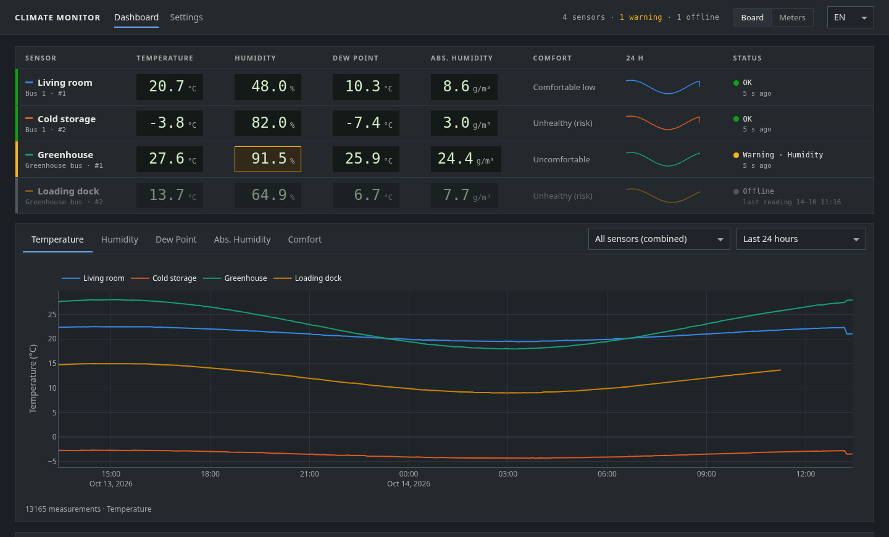
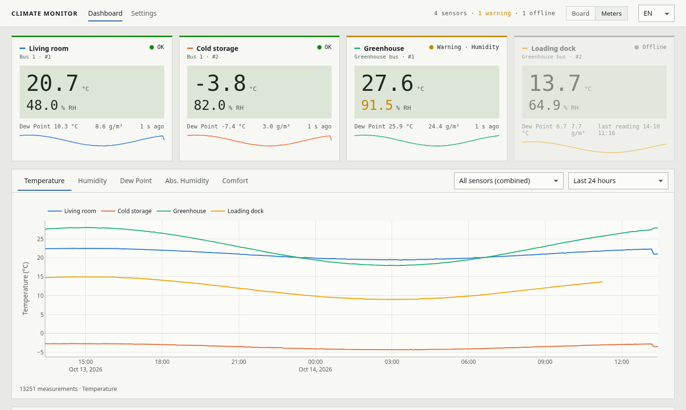
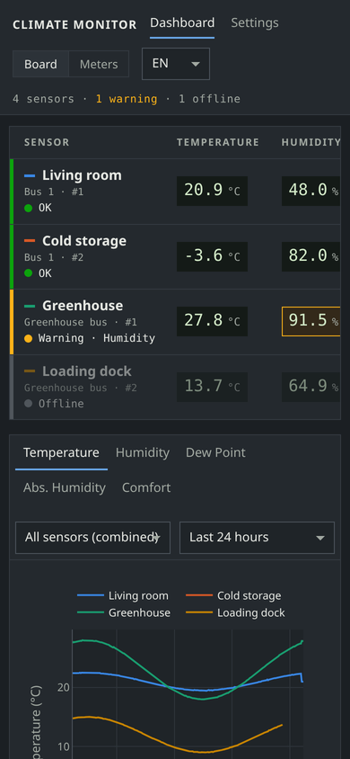
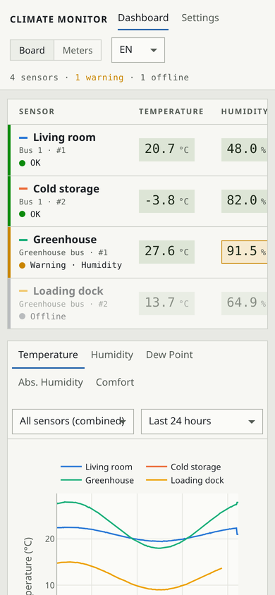
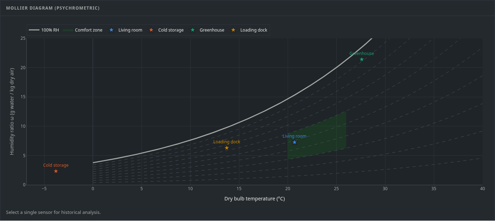
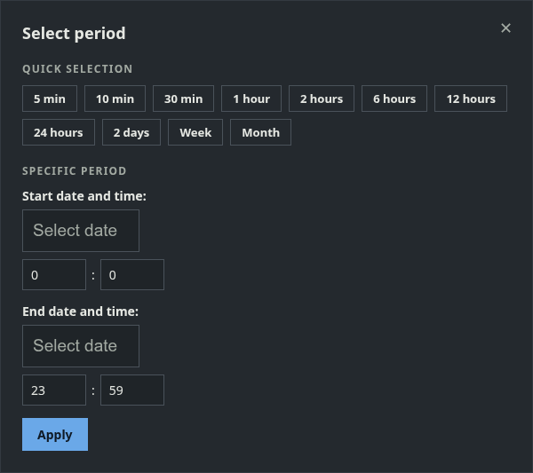
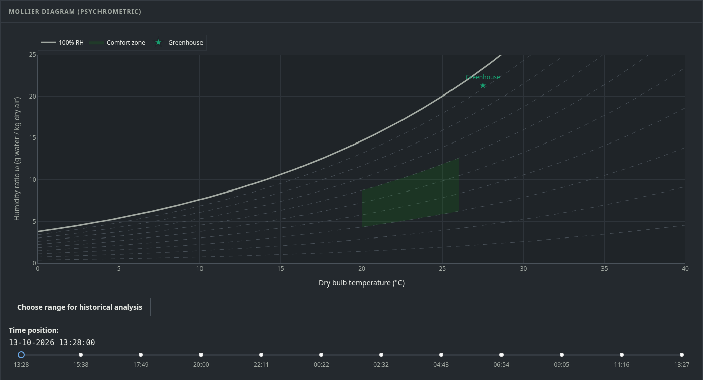
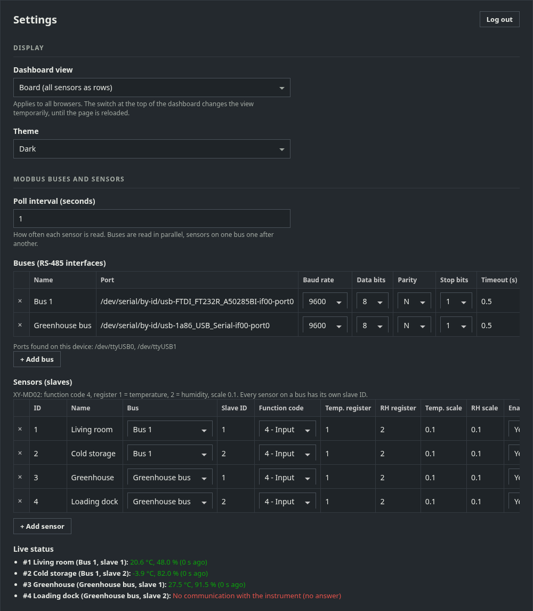
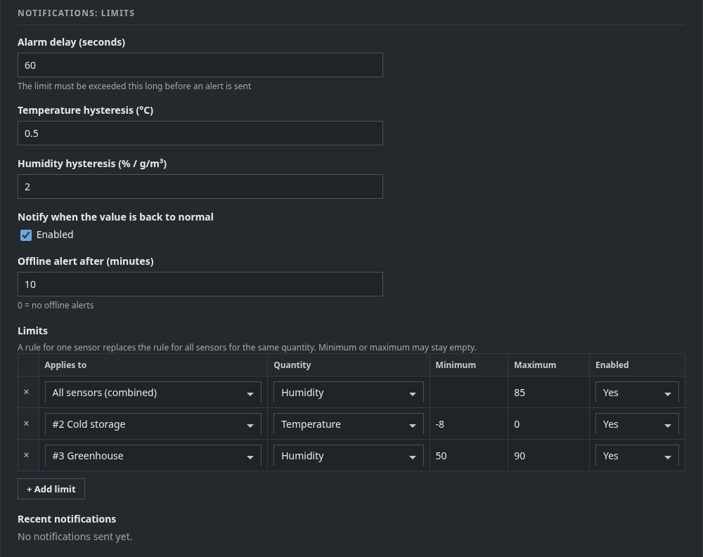

# Climate Monitor
A real-time climate monitoring dashboard for Modbus RTU temperature and humidity sensors (XY-MD02, XY-MD04 and similar) that reads, visualizes and analyzes their data.

<p>
  <a href="https://brdc.nl/en/climatemonitor/">Project page</a> ·
  <a href="https://brdc.nl/nl/climatemonitor/">Nederlands</a> ·
  <a href="https://brdc.nl/de/climatemonitor/">Deutsch</a>
</p>

<a href="https://buymeacoffee.com/Cervezastalone" target="_blank" title="buymeacoffee">
  
</a>

### Features

- **Real-time monitoring**: Live charts with automatic updates (1 second interval)
- **Historical data**: Persistent storage in SQLite database with time filters (1 min to 6 months)
- **Database optimizations**: Table-per-day partitioning, WAL mode, batch inserts for multi-year operation
- **Data retention**: Configurable automatic cleanup of old data
- **Multiple measurements**:
  - Temperature (°C)
  - Humidity (%)
  - Dew Point (calculated)
  - Absolute Humidity (g/m³)
  - Humidex (scientific comfort index)
  - Comfort Score (0-6, based on Humidex)
- **Psychrometric chart**: Mollier diagram with live indicator and comfort zone visualization
- **Historical data replay**: Time-travel through data with preset buttons or custom date/time selection
- **Interactive slider**: Live updates while dragging for smooth historical navigation
- **Scientific analysis**: Humidex formula according to Environment Canada standard
- **Multilingual**: 5 languages fully supported (Dutch, English, German, French, Spanish)
- **Two dashboard views**: *Board* (every sensor as one row, all sensors at a glance) or *Meters* (one panel per sensor)
- **Dark and light theme**: chosen in Settings; layout adapts to phones and tablets
- **Clear status per sensor**: OK, warning, alarm or offline, with the value that is out of limits highlighted
- **Zoom persistence**: Graph zoom stays preserved during live updates
- **Robust**: Extensive input validation and error handling
- **Multiple sensors and RS-485 buses**: several USB/RS-485 interfaces, each with several Modbus slaves; combined and per-sensor graphs
- **Configurable in the browser**: Settings tab for buses, sensors, timezone, language, data retention, server and security
- **Notifications**: Telegram and/or e-mail when limits are exceeded (global or per sensor), when values are back to normal and when a sensor goes offline
- **MQTT**: publish the values of every sensor to an MQTT broker (Home Assistant, Node-RED, SCADA)
- **Login protection**: Admin password for the Settings tab, optionally for the whole app

### Screenshots

#### Dashboard: Board view (dark theme)

*All sensors at a glance: current values, 24-hour trend and status per sensor. Below: one chart with a tab per quantity.*

#### Dashboard: Meters view (light theme)

*One panel per sensor. View and theme are chosen in Settings; the switch at the top changes the view temporarily.*

#### On a phone
<p>
  
  
</p>

#### Mollier diagram

*Current state of every sensor in its own colour, with saturation line, RH curves and comfort zone.*

#### Historical replay


*Pick a period for one sensor and drag the timeline to replay its climate in the Mollier diagram.*

#### Settings

*Display, Modbus buses and sensors with live status.*


*Alarm limits for all sensors or per sensor, alarm delay, hysteresis and the notification log.*

*Screenshots use demonstration data.*

### Requirements

- Python 3.8+
- Modbus RTU device (RS485)
- Windows, Linux or macOS

### Installation

1. **Clone the repository**
```bash
git clone https://github.com/CervezaStallone/ClimateMonitor.git
cd ClimateMonitor
```

2. **Create a virtual environment**
```bash
python -m venv .venv
```

3. **Activate the virtual environment**

Windows PowerShell:
```powershell
.\.venv\Scripts\Activate.ps1
```

Windows CMD:
```cmd
.venv\Scripts\activate.bat
```

Linux/macOS:
```bash
source .venv/bin/activate
```

4. **Install dependencies**
```bash
pip install -r requirements.txt
```

5. **Configure the application**

Copy the example configuration file:
```bash
cp .env.example .env
```

Optionally adjust `.env`. The Modbus values are only used once, to create the first bus and sensor; after that everything is configured in the browser (see [Settings Tab](#settings-tab)):
```env
# Modbus Settings
MODBUS_PORT=COM11
MODBUS_SLAVE_ID=1
MODBUS_BAUDRATE=9600
MODBUS_BYTESIZE=8
MODBUS_PARITY=N
MODBUS_STOPBITS=1
MODBUS_TIMEOUT=1
MODBUS_FUNCTION_CODE=4
MODBUS_REGISTER_TEMP=1
MODBUS_REGISTER_HUMIDITY=2

# Database Settings
DATABASE_FILE=src/modbus_sensor_data.db
DATA_RETENTION_DAYS=0

# Initial values only, change them later in the Settings tab
DEBUG_LOGGING=False
TIMEZONE=Europe/Amsterdam
DEFAULT_LANGUAGE=EN
```

6. **Start the application**
```bash
python app.py
```

The application is now available at: `http://127.0.0.1:8050/`

### Run as a service (start at boot, also without login)

For edge devices that run unattended, install the app as a service. It then starts automatically
when the device boots — nobody has to log in — and is restarted if it stops.

#### Linux / Raspberry Pi (systemd)

In the app folder:
```bash
sudo ./deploy/linux/install-service.sh
```
The script creates the virtual environment, installs the dependencies, gives the user access to
the serial ports (`dialout` group) and installs and starts the `xy-md02` service. The service runs
as the user who ran `sudo` (use `--user <name>` for another user; `--dry-run` shows what would
happen without changing anything). The app folder must be owned by that user or root and must not
be writable by others.

| Task | Command |
|------|---------|
| Status | `systemctl status xy-md02` |
| Live log | `journalctl -u xy-md02 -f` |
| Restart | `sudo systemctl restart xy-md02` |
| Update | update the app files (e.g. `git pull`), then run the install script again |
| Uninstall | `sudo ./deploy/linux/uninstall-service.sh` (data and settings are kept) |

#### Windows

1. Install Python 3.10+ from [python.org](https://www.python.org/downloads/): choose *Customize installation*,
   tick *Install Python for all users* and *Add Python to environment variables*.
   Copy the app to a folder that only administrators can change, e.g. `C:\Program Files\ClimateMonitor`.
2. Open PowerShell **as Administrator** in the app folder and run:
   ```powershell
   powershell -ExecutionPolicy Bypass -File .\deploy\windows\install-service.ps1
   ```
   Changed the port in Settings? Add `-Port <number>` so the firewall rule matches.

This registers the scheduled task **XY-MD02 WebApp** that starts at Windows startup under the
limited built-in *LOCAL SERVICE* account (no login needed), restarts the app if it stops, and opens
the web port in the firewall for domain and private networks (add `-AllowPublic` to also allow
networks marked as public). Output is written to `logs\app.log`.

Put the app in a folder that only administrators can change (e.g. `C:\Program Files\ClimateMonitor`);
the script refuses to install from a folder that normal users can modify.

| Task | How |
|------|-----|
| Status | `Get-ScheduledTask -TaskName 'XY-MD02 WebApp'` or Task Scheduler |
| Log | `logs\app.log` in the app folder |
| Update | update the app files, then run `install-service.ps1` again |
| Uninstall | `powershell -ExecutionPolicy Bypass -File .\deploy\windows\uninstall-service.ps1` (data is kept) |

> After installing, open `http://<device-ip>:8050`, go to **Settings** and set the admin password.

### Project Structure

```
ClimateMonitor/
├── app.py                      # Main entry point
├── database.py                 # Database operations, partitioning, WAL mode
├── modbus_reader.py            # Modbus RTU: one thread per bus, batched database writes
├── devices.py                  # Buses and sensors configuration, live status
├── alerts.py                   # Limits, alarm state, Telegram/e-mail notifications
├── mqtt_publisher.py           # MQTT publishing per sensor
├── psychrometric.py            # Mollier diagram generation
├── callbacks.py                # Dashboard callbacks (board/meters, chart, Mollier, replay)
├── settings.py                 # Settings stored in the database, validation, password reset
├── settings_ui.py              # Settings tab
├── auth.py                     # Admin password, login sessions, protection
├── layout.py                   # Page structure, dark/light theme, styling
├── translations.py             # Texts in NL, EN, DE, FR, ES
├── test_app.py                 # Automated tests
├── deploy/                     # Service install scripts (Linux, Windows)
├── img/                        # README screenshots
├── .env                        # Configuration (not in git)
├── .env.example                # Example configuration
├── requirements.txt            # Python dependencies
├── .gitignore                  # Git exclude rules
├── README.md                   # This file
└── src/                        # Data directory
    └── modbus_sensor_data.db   # SQLite database (not in git)
```

### Using the dashboard

**Status per sensor**

| Status | Meaning |
|--------|---------|
| OK | Value received recently and all limits are met |
| Warning | A limit is exceeded, but the alarm delay is still running (no notification sent yet) |
| Alarm | A limit has been exceeded for longer than the alarm delay; notifications are sent |
| Offline | No valid reading for 3 poll intervals (at least 30 seconds); the last reading time is shown |

The value that is out of limits is highlighted in its cell. The top bar shows how many sensors are
in alarm, warning or offline.

**Views**
- *Board*: one row per sensor with temperature, humidity, dew point, absolute humidity, comfort,
  a 24-hour temperature trend and the status. On a phone the less important columns are hidden.
- *Meters*: one panel per sensor with large values.

Every sensor keeps the same colour everywhere (its marker, trend line, chart line and Mollier point).

**Chart**: choose the quantity with the tabs (temperature, humidity, dew point, absolute humidity,
comfort), and choose *All sensors (combined)* or a single sensor and the time range on the right.

**Mollier diagram and replay**: shows the current state of all sensors. Select one sensor in the
chart to enable *Choose range for historical analysis*.

### Configuration

#### Settings Tab

Open the **Settings** tab in the web app. The first visit asks you to create an admin password
(at least 8 characters). After that you can change, without editing files or restarting:

| Section | Settings |
|---------|----------|
| Display | Dashboard view (Board / Meters), theme (Dark / Light) |
| Modbus buses and sensors | Poll interval, buses (RS-485 interfaces), sensors (Modbus slaves) |
| Notifications: channels | Telegram bot token and chat ID, SMTP server, sender and recipients, test buttons |
| MQTT | Broker, port, TLS, login, client ID, topic prefix, publish interval, QoS, retain, test button |
| Notifications: limits | Limits per quantity (all sensors or one sensor), alarm delay, hysteresis, recovery and offline alerts |
| Region and language | Timezone, default language |
| Data | Data retention (days, 0 = forever), debug logging |
| Server | Listen address and port (*restart required*) |
| Security | Protection level, automatic log-out time, admin password |

**Protection level**
- *Protect settings only* (default): the dashboard is public, the Settings tab needs the password.
- *Protect the whole app*: every page, including the dashboard and its data, needs the password.

Settings are stored in the database. On the first start of this version, values from `.env`
(`DATA_RETENTION_DAYS`, `DEBUG_LOGGING`, `TIMEZONE`, `DEFAULT_LANGUAGE`) are taken over
automatically; after that the Settings tab is leading. If the configured address/port cannot be
used at startup, the app falls back to `0.0.0.0:8050` so the device stays reachable.

**Forgot the admin password?** Run on the device:
```bash
python settings.py reset-password
```
Then open the Settings tab and set a new password straight away.

> The app uses HTTP. On untrusted networks, put it behind a VPN or an HTTPS reverse proxy.

#### Multiple buses and sensors

In **Settings → Modbus buses and sensors**:

- **Buses**: one row per RS-485 interface (USB dongle), with port, baud rate, data bits, parity,
  stop bits and timeout. Ports found on the device are listed below the table. Tip for Linux:
  use the stable `/dev/serial/by-id/...` name, so ports do not swap after a reboot.
- **Sensors**: one row per Modbus slave: name, bus, slave ID (unique per bus), function code,
  temperature and humidity register and scale. XY-MD02: function code 4, registers 1 and 2,
  scale 0.1. Each sensor gets a fixed ID (`#1`, `#2`, ...) that stays the same when renamed.
- **Live status** shows the last values or the last error per sensor.

Buses are read in parallel; sensors on one bus one after another. A sensor that does not answer
or an unplugged interface does not affect the others and is retried automatically. Changes are
applied without restarting the app. Deleting a sensor keeps its measurements in the database.

On the dashboard choose **All sensors (combined)** for one graph per quantity with a line per
sensor, a status card per sensor and all sensors in the Mollier diagram, or select one sensor for
its detailed view and historical replay.

#### Notifications

1. **Channels** (Settings → Notifications: channels)
   - *Telegram*: create a bot with [@BotFather](https://t.me/BotFather) and copy the token.
     Send your bot a message and fill in your chat ID (e.g. from [@userinfobot](https://t.me/userinfobot)),
     or a group/channel ID.
   - *E-mail*: SMTP server, port, security (STARTTLS 587 / SSL 465), username/password, sender and
     one or more recipients (comma separated).
   - Use **Test Telegram** / **Test e-mail** to check the settings before saving.
   - Token and password are never shown again; leave the field empty to keep the stored value.
2. **Limits** (Settings → Notifications: limits)
   - Add a limit per quantity (temperature, humidity, dew point, absolute humidity) with a
     minimum and/or maximum, for *All sensors* or for one sensor. A rule for one sensor replaces
     the rule for all sensors for that quantity.
   - *Alarm delay*: how long a limit must be exceeded before an alert is sent (no alerts for spikes).
   - *Hysteresis*: how far back inside the limit a value must be before it counts as normal again,
     so a value hovering around the limit does not cause a stream of messages.
   - *Notify when back to normal* and *Offline alert after N minutes* (0 = off).
   - The last 20 notifications and their delivery status are listed below the limits. Failed
     messages are retried automatically (up to every hour).

#### MQTT

Enable *Publish values to an MQTT broker* in Settings → MQTT and enter the broker address (and
optionally TLS, username/password, client ID). **Test connection** checks the settings before
saving. With topic prefix `xy-md02` every sensor publishes, at most once per publish interval:

| Topic | Payload |
|-------|---------|
| `xy-md02/status` | `online` / `offline` (retained, `offline` via last will) |
| `xy-md02/<sensor>/state` | `{"device_id": 3, "name": "Kas noord", "temperature": 18.7, "humidity": 62.0, "dewpoint": 11.1, "absolute_humidity": 9.92, "timestamp": "2026-10-14T12:15:43+02:00"}` |
| `xy-md02/<sensor>/temperature` (and `humidity`, `dewpoint`, `absolute_humidity`) | plain value, e.g. `18.7` |

`<sensor>` is the sensor name in lower case with `-` instead of spaces (`Kas noord` → `kas-noord`);
renaming a sensor changes its topic, `device_id` stays the same. If the broker is unreachable,
measuring continues and the app reconnects automatically; the connection status is shown in Settings.

#### Modbus values in `.env` (first start only)

When upgrading, the existing `.env` Modbus configuration becomes *Bus 1* with *Sensor 1*, and all
existing measurements belong to *Sensor 1*.

- `MODBUS_PORT`: Serial port (e.g. COM11, /dev/ttyUSB0)
- `MODBUS_SLAVE_ID`: Slave ID of the device
- `MODBUS_BAUDRATE`: Baudrate (9600, 19200, etc.)
- `MODBUS_BYTESIZE`: Number of data bits (8)
- `MODBUS_PARITY`: Parity bit (N = None, E = Even, O = Odd)
- `MODBUS_STOPBITS`: Stop bits (1, 2)
- `MODBUS_TIMEOUT`: Timeout in seconds
- `MODBUS_FUNCTION_CODE`: Modbus function code (4 = Read Input Registers)
- `MODBUS_REGISTER_TEMP`: Register number for temperature
- `MODBUS_REGISTER_HUMIDITY`: Register number for humidity

#### Database Settings

- `DATABASE_FILE`: Path to the SQLite database file (stays in `.env`, it is needed before settings can be read)

#### Initial values for the Settings tab

Only read once, when the setting has never been saved: `DATA_RETENTION_DAYS`, `DEBUG_LOGGING`,
`TIMEZONE`, `DEFAULT_LANGUAGE`. Listen address and port are set in the Settings tab only
(default `0.0.0.0:8050`).

### Adding a New Language

1. Open `translations.py`

2. Add the language to `LANGUAGE_NAMES`:
```python
LANGUAGE_NAMES = {
    'nl': 'NL',
    'en': 'EN',
    'de': 'DE',
    'fr': 'FR',
    'es': 'ES',
    'it': 'IT'  # New!
}
```

3. Add the translations to `TRANSLATIONS`:
```python
TRANSLATIONS = {
    'nl': { ... },
    'en': { ... },
    'de': {
        'title': 'Modbus Klimamonitor',
        'temperature': 'Temperatur',
        'humidity': 'Luftfeuchtigkeit',
        # ... all other keys
    }
}
```

The dropdown will be updated automatically. Every key must exist in every language with the same
`{placeholders}`; `python test_app.py` and the *Translation Validator* workflow check this.

### Comfort Score & Humidex

The application uses the **Humidex** (Humidity Index) for scientific comfort calculation according to Environment Canada standard.

#### Humidex Formula
```
Humidex = T + 0.5555 × (e - 10)
```
where:
- T = temperature in °C
- e = vapor pressure saturation in hPa (calculated via dew point)

#### Comfort classification based on Humidex:

- **< 20**: Too cold - Score 0
- **20-27**: Comfortably cool - Score 4
- **27-30**: Comfortable - Score 5
- **30-35**: Optimally comfortable - Score 6
- **35-40**: Some discomfort - Score 3
- **40-46**: Great discomfort, avoid physical exertion - Score 2
- **46-54**: Dangerous, heat cramps possible - Score 1
- **> 54**: Heat stroke imminent - Score 0

### Mollier Diagram (Psychrometric Chart)

The application displays an interactive **psychrometric chart** with:

- **Saturation line**: 100% relative humidity curve
- **RH lines**: 10%, 20%, ..., 90% relative humidity
- **Comfort zone**: Marked area (20-26°C, 30-60% RH)
- **Live indicators**: Current condition of every sensor as a star in the sensor's colour
- **Historical marker**: The replayed moment when using historical replay
- **Below 0 °C**: The temperature axis extends automatically so cold rooms stay visible
- **Humidity ratio**: Y-axis shows absolute humidity in g water / kg dry air
- **Zoom & Pan**: Full Plotly interactivity for detailed analysis

This diagram helps to see at a glance whether the climate condition is within the comfort zone and how it relates to saturation limits.

### Historical Data Replay

The application offers advanced historical data analysis with two input methods:

#### **Preset Buttons** (Quick selection)
- **5 min** - Last 5 minutes
- **10 min** - Last 10 minutes
- **30 min** - Last 30 minutes
- **1 hour** - Last hour
- **2 hours** - Last 2 hours
- **6 hours** - Last 6 hours
- **12 hours** - Last 12 hours
- **24 hours** - Last day
- **2 days** - Last 2 days
- **Week** - Last week
- **Month** - Last month

Historical replay works for one sensor: select it in the chart first.

#### **Custom Range** (Precision selection)
- Click **"Choose range for historical analysis"** to open the dialog
- Choose start date and time (hour:minute)
- Choose end date and time (hour:minute)
- Supports same day selection for start and end
- Hour selection: 0-23
- Minute selection: 0-59

#### **Timeline Slider**
- After selecting a period, an **interactive slider** appears
- Drag the slider to "travel" back through time
- **Live updates while dragging**: Chart updates immediately without releasing mouse
- The **psychrometric chart** shows the climate condition position at that moment
- Timestamp is displayed live in DD-MM HH:MM format

**Usage:**
1. Select one sensor in the chart, then click **"Choose range for historical analysis"**
2. Click a preset button, or enter a specific start and end date/time
3. Use the slider to navigate through historical data
4. See how the climate condition changed over time in the Mollier diagram

### Database Architecture

#### Optimizations

The application uses advanced SQLite optimizations for multi-year continuous operation:

**Table-per-day Partitioning:**
- Dynamic table creation: `measurements_YYYYMMDD` (e.g. `measurements_20251205`)
- Automatic table switching at midnight
- UNION ALL queries across relevant day-tables
- Smart table selection based on timerange
- Instant cleanup via DROP TABLE (milliseconds vs minutes for DELETE+VACUUM)

**Write Optimizations:**
- WAL mode (Write-Ahead Logging) for better concurrent performance
- PRAGMA synchronous=NORMAL for faster commits
- PRAGMA temp_store=MEMORY for temporary data in RAM
- Batch inserts: 30-measurement buffer (30 seconds)
- One writer thread for all buses with a persistent connection
- 97% reduction in write transactions (86k/day → 2.9k/day)

**Storage Optimizations:**
- Integer epoch timestamps instead of TEXT datetime (50% space saving)
- Indexed timestamp columns per table
- Configurable data retention with automatic cleanup

**Performance Benefits:**
- Queries only scan relevant days (not entire database)
- 10-100× faster batch inserts vs per-second commits
- No table bloat over time due to partitioning
- Sub-millisecond table drops for old data
- Linear performance independent of dataset size

#### Database Schema (per table)

```sql
CREATE TABLE measurements_YYYYMMDD (
    id INTEGER PRIMARY KEY AUTOINCREMENT,
    timestamp INTEGER NOT NULL,  -- Unix epoch timestamp
    temperature REAL NOT NULL,
    humidity REAL NOT NULL,
    dewpoint REAL,
    absolute_humidity REAL,
    device_id INTEGER NOT NULL DEFAULT 1  -- sensor id (see Settings)
);
CREATE INDEX idx_measurements_YYYYMMDD_timestamp ON measurements_YYYYMMDD(timestamp);
CREATE INDEX idx_measurements_YYYYMMDD_device ON measurements_YYYYMMDD(device_id, timestamp);
```

### Testing

The application includes an automated test suite:

```bash
python test_app.py
```

**Test coverage** (45 tests, also run by the *CI Testing* workflow on every pull request):
- Settings: migration from `.env`, validation, all-or-nothing saving, write-only secrets
- Login: password rules, sessions, throttling, protection levels, redirects
- Buses and sensors: validation, upgrade of existing data, signed register values, failure isolation
- Notifications: limits, alarm delay, hysteresis, recovery and offline alerts, retries
- MQTT: topics, payloads, reconnect behaviour
- Translations: same placeholders in every language, no untranslated text in the layout

### Development

#### Generating requirements.txt
```bash
pip freeze > requirements.txt
```

#### Code Structure

- **app.py**: entry point, starts the Modbus reader, notifications, MQTT and the web server
- **layout.py**: page structure, theme tokens (dark/light) and styling
- **callbacks.py**: dashboard (board/meters, chart, status, Mollier diagram, historical replay)
- **settings_ui.py**: Settings tab
- **settings.py** / **devices.py**: settings, buses and sensors stored in the database
- **modbus_reader.py**: one thread per RS-485 bus, batched database writes
- **alerts.py**: limits, alarm state, Telegram and e-mail notifications
- **mqtt_publisher.py**: MQTT publishing
- **auth.py**: admin password, login sessions, protection
- **database.py**: table-per-day storage, queries, cleanup
- **psychrometric.py**: Mollier diagram
- **translations.py**: texts in NL, EN, DE, FR, ES
- **test_app.py**: automated tests

### Troubleshooting

#### Modbus connection problems
- Check the live status per sensor in Settings → Modbus buses and sensors
- Check if the serial port is correct and listed under the bus table
- Verify the baudrate and other serial settings
- Check the register numbers in the device documentation

#### Database errors
- Ensure the `src/` folder exists
- Check write permissions in the project folder

#### Port already in use
- Change the port in the Settings tab (Server section) and restart the app

### License

This project is open source and available under the [MIT License](LICENSE).
